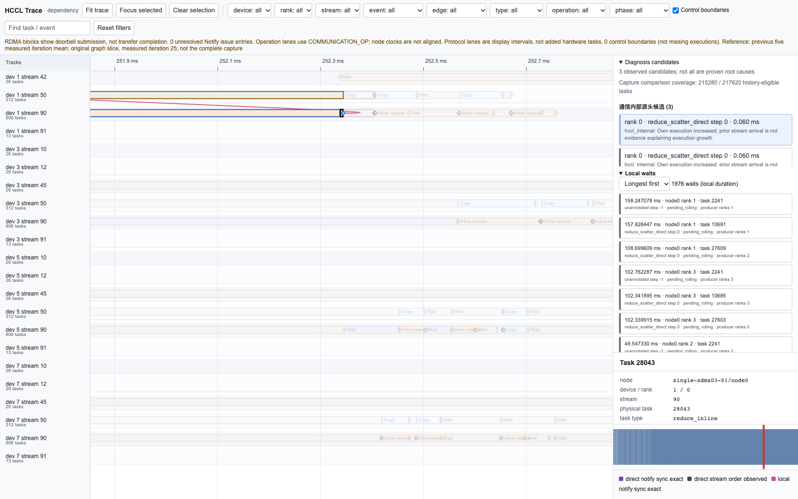
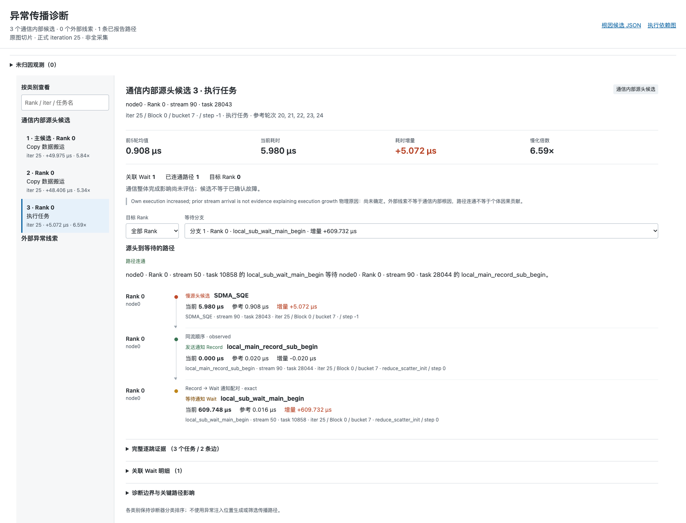

# HCCL-Trace：采集、打点、诊断与实验结果

本文面向第一次了解工具的用户，先讲清楚它能看到什么、怎样诊断、报告怎样读，最后汇总已经做过的实验。
操作步骤另见[从零开始运行训练诊断](从零开始运行训练诊断.md)，接口细节见[诊断工具使用说明](诊断工具使用说明.md)。
需要给他人介绍时，可直接使用[原理、使用与注意事项讲解稿](诊断工具讲解稿.md)。

版本说明：以2026-11-06的`nf`工作树和已核验结果为准。多机低日志续测仍在进行，本文给出结果快照，不把计划数当完成数。

## 1. 这个工具解决什么问题

训练变慢时，看到“某个Rank等了很久”还不够：它可能自己执行慢，也可能只是在等另一个Rank。
HCCL-Trace把**真实设备任务、通信算法标签、训练中的调用位置**放到一起，尝试回答：

- 哪个节点、哪个Rank、哪次集合通信中的哪些任务变慢了？
- 慢的是任务自身执行，还是Host迟迟没有发起调用，或者只观察到了等待？
- 沿实际通知关系，哪些等待可能受到了它的影响？

**输出是有证据的源头候选，不是自动确认“某张卡坏了”或“物理网络故障”。**
生成报告、数据关联正确、异常定位正确，是三个不同的验收目标。

### 先认识几个名字

| 名词 | 可以怎样理解 |
| --- | --- |
| Node / Rank / Device | Node是机器；Rank是通信参与进程；Device是实际设备编号。三者不能互相代替或直接推算。 |
| iteration | 一轮训练。预热轮和正式轮分开，诊断参考使用正式轮。 |
| collective | 一次集合通信，例如AllReduce。一次调用会展开成许多内部小任务。 |
| phase / step | 通信算法内部的阶段和步骤，例如ReduceScatter、AllGather；不是训练iteration。 |
| bucket / call_site | 训练中的通信位置。DDP梯度桶是其中一种；其他负载可用自己的公开调用位置。 |
| Record / Wait | 一个任务发出通知，另一个任务等待通知；诊断沿有证据的通知关系解释等待。 |

本文实验轮次沿用日志的0基编号：iteration 25是正式轮编号25，不含预热轮，并非从1开始数的第25次。

## 2. 采集与打点分别做什么

可以把它理解成三份相互核对的记录：

```text
msprof：真实任务何时执行、执行多久、在哪条流上
HCOMM语义打点：这个任务属于通信算法的哪个阶段、步骤和参与端
训练侧SDK：这个集合通信发生在第几轮、哪个公开调用位置
                         |
                         v
                 只读离线分析（CPU）
          数据检查 -> 精确关联 -> 依赖图 -> 对比诊断
                         |
                         v
       execution.html + root_causes.json + propagation.html
```

### 2.1 msprof：记录实际执行

采集期间，msprof记录设备任务时间线、Host API及相关元数据；导出后，工具读取consolidated
`msprof_*.db`。当前生产链支持DB schema `1.2.0`，不拿旧CSV或Chrome-trace JSON补配。

下面列的是诊断涉及的主要记录，不代表任意模型只会出现这些任务：

| 记录/任务 | 训练中通常在哪里出现 | 诊断用途与边界 |
| --- | --- | --- |
| SDMA / Copy | 通信内部搬运；训练数据、张量转换等非通信位置也可能有Copy | 看本地搬运耗时；只有关联到HCCL调用后，才属于通信内部任务。 |
| Inline Reduce等归约执行 | AllReduce / ReduceScatter等内部 | 观察通信内部归约的自身慢化，不等于整个训练计算阶段。 |
| RDMA相关任务 | 跨机或使用RDMA的通信路径 | 记录提交及协议事实；提交返回不是逐笔硬件传输完成。 |
| Notify Record / Wait | 通信内部的流间、Rank间协作 | 构建通知依赖，区分发通知一侧和等待一侧。Wait长不自动等于源头。 |
| AI_CPU、FFts相关执行/上下文 | 取决于设备和通信执行路径 | 关联实际执行与算法语义；不是每个父kernel都有可比较的细粒度语义。 |
| 普通计算TASK及算子元数据 | 前向、反向、优化器更新等 | 当前基础时间线仍可能包含它们；工具不因此声称诊断任意计算算子异常。 |
| Host API | 算子提交、集合通信提交、运行时调用等 | 将公开通信调用与真实执行绑定；API耗时不等于设备执行耗时。 |
| AI Core/AIV性能指标（PMU） | 计算核性能采样，取决于采集参数 | 可选数据，当前低开销验证配置已关闭；不是通信诊断必需的输入。 |

**这些数据来源于在线采集，但DB解析、语义合并、构图和诊断是在训练后离线完成的。**
记录数多不等于训练开销一定最大；还要看日志级别、采样、缓冲、写盘和导出成本。

### 2.2 HCOMM打点：给通信任务贴上算法标签

我们的配套通信库给任务记录算法、phase、step、Rank/peer、分片等已有语义。
例如，普通时间线里的一个Copy，可进一步识别为“本次AllReduce中ReduceScatter某一步的搬运”。

实现上，在任务创建时保存一次语义快照，异步执行时读取该任务自己的标签。
不是到任务执行时再读取可能已经变化的线程上下文。

- 默认关闭，`HCCL_STEP_TRACE=1`开启，兼容`HCCL_TASK_SEMANTIC_TRACE=1`。
- 不为打点额外插入设备任务，不用标记kernel制造时间线。
- 按真实node/device/stream/task等身份精确关联，不用“时间最近”猜匹配。
- 日志中的Host提交时间不能冒充设备任务执行时间。

已有Ring（含concurrent-direct/standard Ring）、Mesh、NHR相关实现和指定样例验证，
但不等于所有硬件、算法选路、算子和transport组合都已覆盖。RHD不在后续集成计划中。

### 2.3 训练侧SDK：把通信放回训练上下文

`hccl_trace.Trace`记录公开的group、iteration和collective调用位置，以及已有真实同步之后的完成边界。
它补充的是“这次调用在训练中的位置”，不是替代msprof计设备时间。

SDK本身不执行NPU同步、不新增设备任务、不改通信算法。异步调用返回只表示提交返回；
只有训练本来就发生的设备同步，才可以作为相应的完成观测。
DDP/FSDP等框架需要在实际通信hook或调用处接入，只在整个`backward()`外包一层不能自动识别每个集合通信。

### 2.4 现在怎样降低开销

当前已验证的低日志方案，重点是**少写普通调试日志，保留诊断所需事实**：

1. 使用全局WARNING，解除额外模块日志覆盖，减少大量普通INFO日志。
2. 在配套新Device包中，语义开启时单独保留四种必要日志：kernel身份、主流任务身份、op/rank、输入输出地址及大小。
3. 保留HCCL、TASK L1和ASCENDCL采集，关闭AI Core性能指标。

这不是“只采通信任务”的在线过滤。普通计算TASK/API仍会出现。
尝试关闭`task-time`或`ascendcl`会丢失必要事实，已被严格门禁拒绝，不能作为可用方案。
旧Device包直接调成WARNING也曾丢失地址/anchor，导致SDK精确绑定失败；必须使用配套的新包。

## 3. 诊断是怎样做出来的

### 第一步：先检查数据是否够用

检查DB、语义版本、执行身份、公开调用绑定和Notify配对；缺失、重复、歧义明确保留。
“语义100% exact”表示本次参与关联的语义记录精确匹配，不是“所有物理任务都有标签”，更不是“诊断准确率100%”。

### 第二步：建立真实依赖

先建立执行图，再派生资源视图。典型关系包括同流先后顺序、已配对的Record→Wait和有证据的跨Rank通知。
不因为两个任务时间相近、Rank相邻或notify ID相同，就直接补一条因果边。
证据不足时保留断点或歧义，不把图画完整作为目标。

### 第三步：判断“比正常慢了多少”

| 模式 | 参考来自哪里 | 适合什么场景 |
| --- | --- | --- |
| Rolling | 同次运行前5个正式轮中，相同位置且结构可比较的任务 | 有重复训练轮次、希望不另跑正常基线。需要公开调用/轮次绑定。 |
| Baseline | 另一份独立正常运行，相同负载配置和可比调用 | 已有正常对照，或无法提供足够的同次历史。 |

当前实验的Rolling源头预选使用前5正式轮均值、1.5倍及3MAD，另用20%下游门槛观察等待。
MAD可以理解为“历史波动有多大”：既看变慢比例，也避免把普通抖动当异常。
Baseline使用自己的中位数/MAD等规则，不是直接复用Rolling阈值。
参考不足或结构不一致会显示`insufficient_history`、`not_comparable`，不等于正常。

### 第四步：区分源头候选和等待症状

- **通信内部执行候选**：任务自身耗时明显增长，例如SDMA或归约执行。
- **Host准备/调用前迟到**：公开Host区间异常，且有相应通信影响证据；它不是一个设备task。
- **协议区间、长Wait或未归因观测**：提示哪里在等，不能直接等同于网络物理根因。

通用CLI默认是`--source-policy legacy`。
`dual`和`dual-v2`必须显式选择，是实验策略；后者用于当前多机源头排序。
它们可以发布局部执行候选，即使暂时没有足够证据发布传播链。本文实验结果不能套给所有默认配置。

### 第五步：解释已经有证据的传播

沿原图展开“源头任务→控制任务→Record→慢Wait”，给出每一跳的身份和证据等级。
有校时支持才解释跨机时间关系；没有适用校时，只报告拓扑和本地时长。
路径连通不意味着某个Wait的全部增量都由该候选造成，也不保证已经找全所有下游。

当前没有完整逐笔RDMA硬件完成计时，不能把协议区间叫纯网络传输耗时，
也不能给出已经证明准确的跨节点全局关键路径。

## 4. 最终结果长什么样

### 4.1 默认交付三个文件

```text
results/
  execution.html       执行依赖图与候选位置
  root_causes.json     结构化诊断结果
  propagation.html     源头到等待的证据路径
```

HTML自带展示数据和脚本，可离线打开，不需要部署网页服务。
使用所选轮次视图时，报告是**完整分析之后截取的该轮原图**，不是所有训练轮次；
要复查完整图，应保留原始输入及`--keep-debug`中间结果。

### 4.2 执行图：看任务在哪里、谁依赖谁

下图来自真实单机SDMA实验801，选择了第三个候选。不是示意图，也没有重新构造图边。



- 横轴是时间，泳道按实际设备/stream展开，方块是实际执行或控制任务。
- 右侧列候选、等待和选中任务的身份；可筛选Rank、stream、phase、operation等。
- 选中候选后查看其上下文和已报告依赖，不必在全量训练时间线里逐个寻找。
- 图中RDMA块表示提交事实；界面中的时间和边仍受相应证据限制。

### 4.3 传播报告：看“为什么认为它影响了这个等待”

同一实验中，第三个候选有一条已发布路径。主候选没有路径，所以这里特意切换到第三个，
不能把这张截图说成“三个候选都有传播证明”。



读图顺序是：左侧选候选，先看Node/Rank/训练位置，再看前5轮均值、当前耗时和增量，最后看路径。
图中该任务从0.908µs变为5.980µs，随后有同流顺序和精确通知配对连接到一个慢Wait。
两段增量不同，工具没有把它们强行解释成一笔等量的因果贡献。

候选可以有多条等待分支，也可以没有可发布路径；没有路径时应明确显示缺口，而不是补画箭头。
两张截图的源报告SHA和选择位置见[截图来源](图片/诊断报告样例/sources.json)。

### 4.4 JSON：供程序、复核和汇总使用

`root_causes.json`保留的不只是一个“故障Rank”，还包括：

| 信息 | 读它时应该关注什么 |
| --- | --- |
| 状态、策略和参数 | 本次用了哪种诊断方法；是否定位、是否存在比较限制。 |
| 数据质量、覆盖率和调用绑定 | 多少记录能关联、多少任务可比较；它们不是准确率。 |
| 候选及首选源头 | Node/Rank/stream/task或Host区间、训练位置、历史值、当前值、增量、选择依据。Host与设备任务分开。 |
| 外部线索及未归因观测 | 不把未解释的长Wait、协议异常或外部线索偷偷算成已定位根因。 |
| 传播与分析范围 | 原图节点/边、路径、所选轮次和证据限制；不是另外猜出的依赖。 |

例如801主候选是Rank0正式第25轮的一项SDMA：历史均值10.3234µs，当前60.298µs，
增加49.9746µs，约5.84倍。报告可证明“自身执行变长”，但其物理原因仍是`unknown`。
在dual策略中，首选还可能是独立Host区间，应看首选源头字段，不能只把`candidates[0]`当统一答案。

### 4.5 除三份报告，还应该留什么

| 层次 | 典型产物 | 用途 |
| --- | --- | --- |
| 原始采集 | 每节点plog、`msprof_*.db`、SDK公开观测、多机校时探针、采集清单 | 重新分析的事实基础；三份HTML/JSON不能替代原始采集。 |
| 离线中间结果 | 合并CSV、绑定结果、执行/资源图、检查结果、任务比较、传播JSON/CSV | `--keep-debug`保留，便于审计和开发；具体布局随入口而异。 |
| 实验验收证据 | `sealed.json`、`evaluation.json`、`effect-evidence.json`、选择记录 | 封存诊断后独立检验是否命中、注入是否真正影响通信。不是日常CLI默认产物。 |
| 运行安全与留档 | 恢复核验、归档SHA清单、留存/清理凭证 | 证明设备/包/端口恢复，说明原始数据现在在哪里、是否还能完整重放。 |

我们的实验坚持**先封存诊断，再独立读取注入真值评测**，不使用“知道注入在哪”来挑候选。
注入效应通过仅表示实际窗口观测到符合门槛的通信慢化，不单独证明物理因果。

## 5. 已经做过的实验：怎样理解数字

主要负载是GPT-2 Small DDP，单机4Rank、多机两节点各4Rank；每次10轮预热、50轮正式。
这些结论对应指定负载和采集配置，不代表任意模型已经验收。

- **候选命中数/候选总数**：发布的候选中，有多少满足同Node、预声明受影响Rank、实际时间区间正重叠。
- **任一命中实验数**：一组实验中至少一个候选命中。
- **首选命中实验数**：该组首选源头命中。不是“候选数越多越好”。
- 通信竞争两端都可能受影响，所以同时报告预声明两端与仅主目标Rank；Host区间与设备task分单位。
- “未运行”“注入无效”“注入有效但漏诊”必须分开，不能只统计最好结果。

### 5.1 单机30组汇总

这30组由新SDMA固定位置重复10组、较早的通信竞争10组及Host调用前迟到10组组成，
不是一次统一随机测试。120份Rank数值及相应语义、图门禁通过。

| 异常 | 命中候选/全部候选 | 任一命中 | 首选命中 | 漏诊 |
| --- | ---: | ---: | ---: | ---: |
| SDMA竞争，新持续Copy方法 | 30/30执行task | 10/10 | 10/10 | 0 |
| 通信竞争，预声明两端 | 32/35执行task | 9/10 | 9/10 | 1 |
| Host调用前迟到500ms | Host 8/8；执行task 0/8 | 8/10 | 8/10 | 2 |

这份分批清单中任一及首选均为27/30（90%），**不是一般准确率，也没有验证正常误报率**。
Host类整体是8/16个候选，不能只报Host区间8/8而省略误选的8个执行任务。
通信仅主目标Rank口径为23/35，任一及首选6/10；两端命中不代表精确区分了竞争源端。

SDMA新方法是在选中桶异步提交后启动单后台2GiB D2D，覆盖至本轮设备同步，另设5秒活动上限。
10组均有30～51个目标Rank/轮次内部SDMA满足前5均值2倍/3MAD并与逐次Copy包络重叠。
但10次均固定Rank0、第25正式轮及同桶种子，证明的是该位置重复性，不是随机位置泛化能力。
三类分别保留31、27、13条报告路径，失败实验的路径也在其中，不能都解释为真实注入传播。

**历史失败仍然保留：**较早的短Copy10组是0/41候选、0/10实验命中，只有2/10观察到原门槛下的强通信慢化；
计算通信竞争10组是0/30、0/10，尽管窗口内都有资源慢化事实，仍未定位成功。
它们属于旧40组账本；其中通信和Host的20组又被上表引用，不能把30与40相加说成70组独立验证。
新持续Copy不是在相同独立位置矩阵上的严格受控A/B试验。

### 5.2 旧多机4组：同输入离线优化的结果

Node0+Node3共8Rank。下表来自旧采集在dual-v2排序优化后的回放，
**这些输入参与过方法开发，不是4次新的独立验证。**

| 异常 | 命中候选/全部候选 | 任一/首选命中 | 已报告路径 |
| --- | ---: | --- | ---: |
| SDMA竞争 | 3/3执行task | 1/1、1/1 | 0 |
| 通信竞争，预声明Rank0/4 | 8/8执行task | 1/1、1/1 | 5 |
| Host调用前迟到 | 1/1 Host区间 | 1/1、1/1 | 1，带时间限制 |
| RoCE原生20Gbps限速 | 6/6执行task，实际窗口口径 | 1/1、1/1 | 0 |

修正独立评测窗口后是4/4，但不能写成“多机准确率100%”。同批正常输入仍有4个误报候选，
计算竞争仍是0/4；旧策略最初定位失败的原结果也保留。
通信8个候选都在预声明另一端Rank0；只看主目标Rank4则为0/8、0/1。

**RoCE的0/6变成6/6是什么意思？**
候选没变、诊断没重跑。旧评测窗口错误地从较晚的counter采样开始；独立控制日志表明，
首次实际读回20Gbps比它早619.242ms。按真实生效窗口另算，这6个候选都与之重叠。
因此是评测时间窗口核正，不是算法突然多找出6个根因。旧窗口0/6也没有被覆盖。

### 5.3 新独立多机样例：仍有真实漏诊

以下不能并入旧4/4，也不能因为数据门禁通过就算定位成功。

| 独立样例 | 真实注入与效应 | 最终选择 | 严格命中 |
| --- | --- | --- | --- |
| 旧900批首例901，INFO配置 | Node3 Rank4、第12轮Copy；45个内部SDMA达到2倍/3MAD且与126次完成Copy各自包络重叠 | Node0 Rank0、第16轮的3个候选 | 0/3；任一/首选0/1 |
| 新低日志批首例1002 | Node0 Rank0及Node3 Rank4、第12轮通信竞争；56个内部执行任务满足效应门槛，222个慢Wait | Node3 Rank6、第25轮的2个候选 | 0/2；任一/首选0/1 |

两例8Rank数值通过，每例517538条语义exact、271082个Wait全部配对，仍选错了位置。
目前证据说明“数据能完整进入诊断”和“源头排序能可靠泛化”不是一回事，不能把漏诊都归咎于没采到数据。
这些事实尚不足以确认具体物理原因或一个唯一的排序缺陷，不应事后用真值强行纠正报告。

低日志续测计划19组：Copy4组，其余三类各5组，旧901单列。
本节快照截至2026-11-06 22:14:59（北京时间）：完成诊断、独立核验及两节点归档的是1/19，
下一组Host迟到仍在队列处理，未计作独立完成。其余18组未完成，不提前计成功或失败。
后续进度见本工作区[动态结果索引](../artifacts/multinode19-lowlog-20261106-1000/latest-results.md)，不是本节固定结论。

### 5.4 采集开销：降低后观察到了什么

新低日志Device方案在单机4Rank、无异常注入的同一完整对照块中得到：

| 模式 | 正式轮平均耗时 |
| --- | ---: |
| WARNING，无语义、无msprof | 129.056855ms |
| WARNING，仅语义 | 129.340743ms |
| WARNING，语义+msprof，关闭PMU | 129.726596ms |
| INFO，语义+msprof，关闭PMU | 540.636898ms |

口径为每轮取四Rank同步耗时最大值，再对50正式轮取均值；不含启动、导出和离线诊断。
低日志采集较INFO采集下降76.00%，日志从1026.93MiB降至162.99MiB；较同包低日志未采集基线增加约0.519%。
排查对照说明，普通INFO日志及其与profiling的交互是该场景主要可见成本，不能简单说“全是语义打点”或“全是msprof本身”。
关闭PMU对数据量有帮助，但之前一块对照的训练耗时仅下降0.81%，不能靠它解释此前全部高开销。

**这里只完成一个完整配对块。**原计划12次实际完成5次，余7次未跑，不能给出稳定开销或置信区间，
也不能承诺任意负载或多机都只有0.52%开销。
新包三份profile各有224840条语义精确关联、3072个SDK调用精确绑定；一份低日志输入完整原生诊断通过、117064个Notify配对。
这证明新配置保住了必要事实和功能链路，不等于已验证异常定位率或误报率。

## 6. 使用时应该怎样把握边界

目前可以做：在已适配的通信路径上，采集真实执行、关联训练位置、对比任务慢化，并用已有依赖解释部分等待。
已经支持单机和多机离线分析，报告能保留未定位、歧义、时间和物理归因限制。

目前不能保证：任意workload零接入、所有算法/选路全覆盖、只采通信而完全不采其他TASK、
跨机逐笔RDMA硬件完成时间、普适根因准确率、正常低误报率，或固定的低开销百分比。

实际使用建议按[通用教程](从零开始运行训练诊断.md)完成：环境与配套库检查、训练接入、正式采集、
数据门禁、离线诊断、报告阅读和设备恢复。先验证自己的真实通信路径能绑定，再讨论候选好坏。
普通用户只做诊断，不需要复现我们实验中的异常注入或设备策略修改。

### 证据与进一步阅读

- 实现与接口：[诊断工具使用说明](诊断工具使用说明.md)、[实现规格](../hccl/tools/diagnosis/spec.md)、[多机计时边界](../hccl/tools/diagnosis/multinode-communication.md)。
- 单机实验记录：[旧40组](../hccl/tools/diagnosis/single-gpt40-20261103.md)、[新SDMA十组](../hccl/tools/diagnosis/single-sdma10-20261104.md)。
- 多机记录：[旧样例离线优化与窗口审计](../hccl/tools/diagnosis/multinode-refinement-20261103.md)、[低日志19组接续](../hccl/tools/diagnosis/multinode19-lowlog-20261106.md)。
- 本工作区封存汇总：[30组单机与4组多机](../artifacts/experiment-summary-20261105/README.md)、[低日志开销记录](../artifacts/tool-lowlog-20261106/README.md)。

本文及截图可随源码阅读；`artifacts/`、`test/out/`原始数据和现场HTML报告不随Git克隆发布，
上面的“本工作区”证据链接需要实际留档目录。600批和800批多数成功例已按当时规则清理大输入，
不能声称这些实验都可全量重放；已核验归档的新多机901/1002保留完整原始输入和全图，可从压缩包无损恢复。
